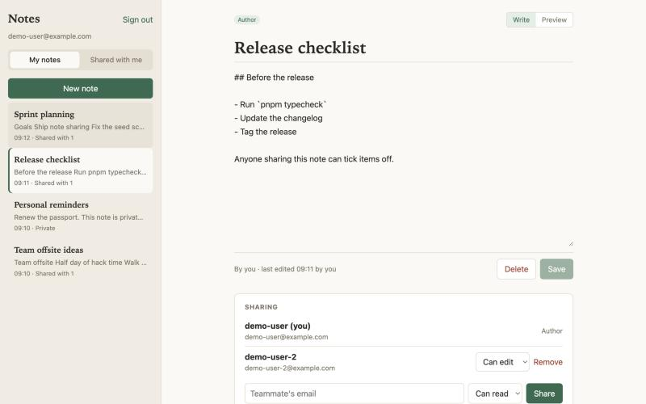
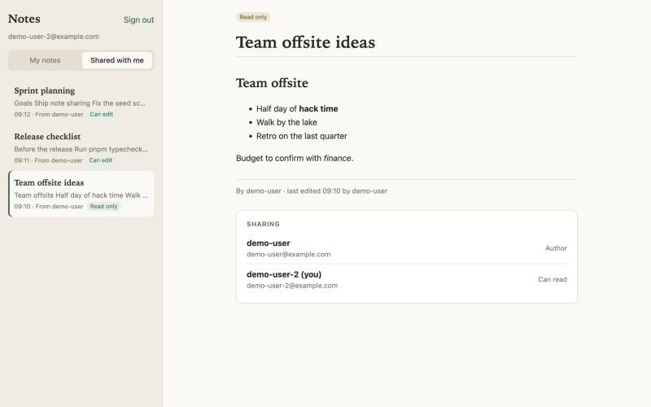

# Notes app

A collaborative notes example for the platform (Vite + React + TypeScript + supabase-js). Each user writes notes in plain text or light markdown and shares them with other users of the app, by email, read-only or with edit rights.




## What's inside

- `src/`: the frontend, with three views: "My notes", "Shared with me" and the note editor (sharing, last editor).
- `supabase/migrations/`: `profiles` (filled from `auth.users` by a trigger), `notes` and `note_shares`, with row level security. A user only sees their notes and the notes shared with them; an editor can change the title and content, but only the author can delete a note or manage its shares.
- `supabase/functions/share-note`: shares a note with a user by email (`POST { note_id, email, permission: "read" | "edit" }`). Only the author can call it; an email without an account in the app is rejected.

## Run and deploy

```bash
cp .env.example .env.local   # VITE_SUPABASE_URL and VITE_SUPABASE_ANON_KEY of your app
npm install
npm run dev
npm run build                # typecheck + production build
```

On the platform, ask Claude Code to "deploy the app to the platform" from a copy of this folder. `deploy/install.sh --seed` deploys it as `notes-app`, with two users who share notes: `demo-user@example.com` and `demo-user-2@example.com` (password `demo-password`).
